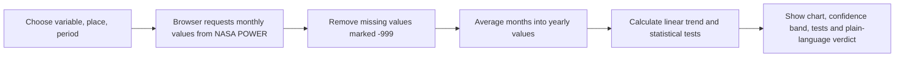
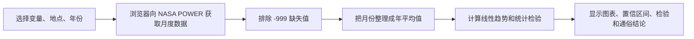

# How Trend Detective moves data

## English

A student chooses a variable, a place and a period. The browser requests that variable’s monthly values from the NASA POWER API. Trend Detective skips NASA’s `-999` missing-value marker, groups the valid months into one annual mean (or the selected month/season), and draws the time series with a linear trend line and 95% confidence band. It then calculates the least-squares rate, Sen’s slope, Mann–Kendall test and a slope t-test, and turns those results into a plain-language summary. The browser does the calculations; no application server is involved.

## 中文

学生选择一个变量、地点和时间范围。浏览器直接向 NASA POWER API 请求这个变量的月度数据。Trend Detective 会跳过 NASA 用 `-999` 表示的缺失值，把有效月份整理成年平均值（也可以按所选月份或季节计算），再绘制时间序列、线性趋势线和 95% 置信区间。随后计算线性变化率、Sen 斜率、Mann–Kendall 检验和斜率 t 检验，并用简单的话解释结果。所有计算都在浏览器内完成，不需要应用服务器。

## BM ringkas

Pengguna memilih pemboleh ubah, tempat dan tempoh. Pelayar meminta data bulanan daripada API NASA POWER, mengetepikan nilai hilang `-999`, mengira purata tahunan (atau bulan/musim yang dipilih), kemudian mengira kadar tren dan ujian statistik. Carta, julat keyakinan 95% dan kesimpulan bahasa mudah dipaparkan terus dalam pelayar tanpa pelayan aplikasi.
